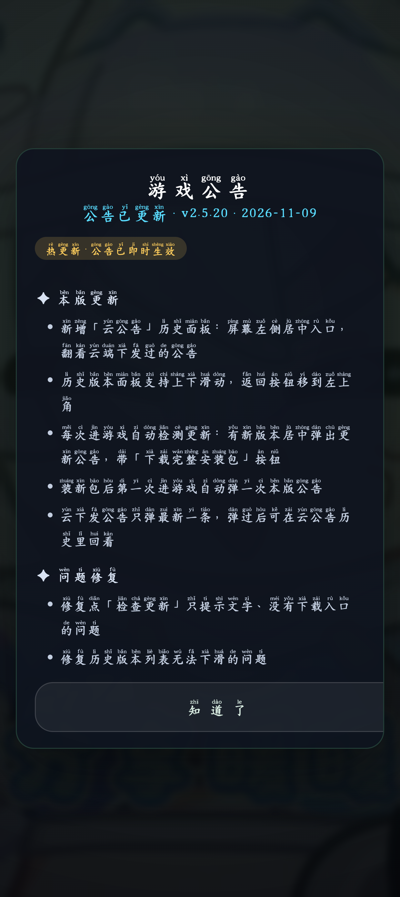
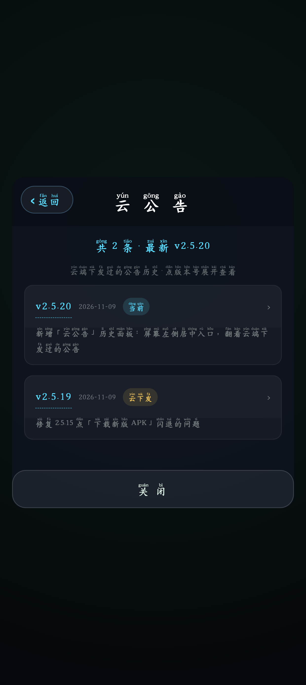
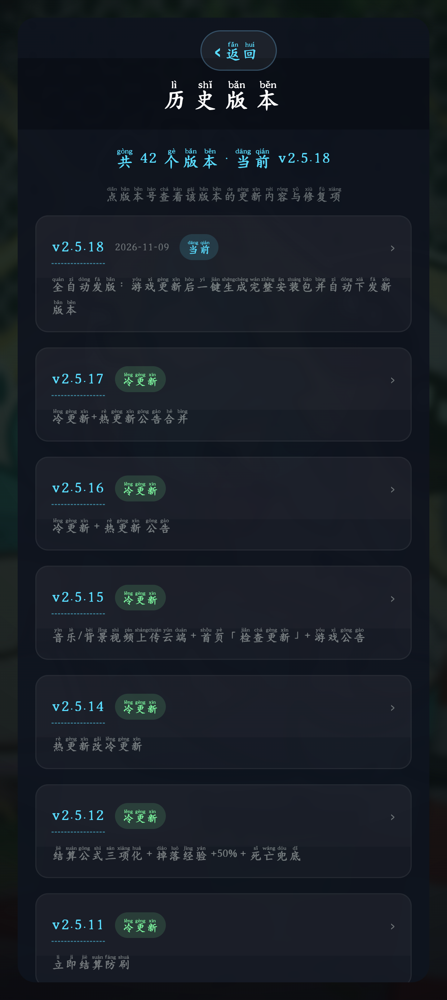

# 无尽割草 · Endless Mow

> 一款「吸血鬼幸存者」式的无尽割草小游戏，纯 HTML5 Canvas2D 手工打包成安卓 APK。

| | |
|---|---|
| **安装包** | `dist/survivor-2.5.31.apk`（约 160 MB · 已含 8 个首页背景视频） |
| **版本** | 2.5.31 · versionCode 63 · minSdk 24（Android 7.0+） |
| **包名 / 签名** | `com.mow.survivor` · debug keystore（v2/v3 签名，2.1.1 起固定） |
| **技术栈** | Android 原生壳（横屏全屏 WebView）+ 纯本地 Canvas2D 游戏逻辑 |
| **更新方式** | **全冷更新 + 公告热更新** — 游戏本体全部内置在 APK 里，装新 APK 才更新；只有「公告」会运行时从云端拉取，改公告不必发版 |

---

## ✨ 特色

- **波次制割草**：每波清完休息 10 秒，每 5 波随机刷一只 BOSS；怪物有独立等级，随波数成长
- **6 档难度**：简单 → 普通 → 困难 → 地狱 → 噩梦 → 屌炸天，屌炸天每波全属性再 +2%
- **5 个职业**：游侠 / 法师 / 守卫 / 刺客 / 猎人，各有初始武器与被动，闯关或金币解锁
- **10 把武器 + 15 种被动**，全部无等级上限，升级**五选一**
- **两个商店**：首页商店（永久金币）+ 战斗商店（每 5 波，本局金币）
- **8 种 BOSS**：巨战王 / 水晶法师 / 重炮王 / 影杀王 / 泰坦巨像 / 瘟疫使者 / 育母 / 风暴领主，随机生成、各有技能
- **11 首内置曲** + 自由导入（IndexedDB 持久化）+ 顺序 / 单循 / 随机三种模式
- **右侧滑出公告面板**：冷更新 / 热更新标签合并展示，可翻看全部历史版本，点版本号展开该版的更新内容与修复项
- **左侧「云公告」竖排入口**：单独记录云端每次下发过的公告（只弹最新一条），历史随时回看
- **居中更新弹窗**：进游戏 1.5 秒自动检查，有新版本就弹窗并带「下载完整安装包」按钮（显示包体大小）
- **历史列表可滑动**：版本多时可上下滚动，返回按钮固定在该面板左上角
- **零依赖运行**：一个 APK 就是全部，无网络也能完整游玩

---

## 📲 安装

1. 把 `dist/survivor-2.5.25.apk` 传到手机（微信传文件 / 数据线 / 网盘都行）。
2. 点击安装；系统提示「未知来源应用」属正常（自签名测试包）。
3. 桌面出现「无尽割草」图标（你上传的那张图），点开直接进游戏。

> 从 2.1.1 起签名已固定，可直接覆盖安装、存档保留。
> **仅从 2.1 或更早版本升级时需先卸载一次**（旧版私钥丢失无法续签，卸载会清掉存档与导入的音乐）。

---

## 🎮 玩法

### 基本操作

- **横屏持机**。按住屏幕左半区拖动出现摇杆（可在设置里切固定/浮动），键盘支持 WASD / 方向键。
- 武器默认**全自动开火**；设置里关掉「自动打怪」后右下角出现 ⚔ 攻击键（飞刀需手动，带辅助瞄准锁定，其余武器仍自动）。
- 击杀掉**经验宝石**（走近吸取，拾取半径可升级）与**金币**（全局 +30% 掉落）。

### 成长

- 所有武器 / 被动**无等级上限**；每级所需经验 = 100 × 1.3^(等级−1)。
- 每清完一波**保底升一级**；怪物等级与玩家等级互差锁定在 5 级以内。
- 死亡时按 `5 + 击杀×1.5 + 存活秒数×0.6 + 等级×20` 结算金币进首页商店钱包。

### 难度（点「新游戏」选择）

| 难度 | 怪物血量 | 受伤减免 | 伤害 | 移速 | 攻频 | 经验 | 每级成长 |
|---|---|---|---|---|---|---|---|
| 简单 | ×0.8 | −10% | ×0.9 | ×0.9 | ×0.9 | +20% | +3% |
| 普通 | ×1.0 | — | ×1.0 | ×1.0 | ×1.0 | ×1.0 | +5% |
| 困难 | ×1.15 | −10% | ×1.05 | ×1.05 | ×1.15 | +15% | +7% |
| 地狱 | ×1.3 | −20% | ×1.1 | ×1.1 | ×1.4 | +40% | +9% |
| 噩梦 | ×1.4 | −30% | ×1.2 | ×1.2 | ×1.5 | +50% | +11% |
| 屌炸天 | ×1.5 | −30% | ×1.3 | ×1.3 | ×1.8 | +90% | +14% · 每波全属性再 +2% |

> 所有难度受伤减免封顶 80%；屌炸天之外 BOSS 数量封顶 20 只。

### 职业（首页「角色」页）

| 职业 | 初始武器 | 特点 | 解锁方式 |
|---|---|---|---|
| 🗡 游侠 | 飞刀（手动瞄准） | 移速 +12% | 初始可用 |
| 🔮 法师 | 雷击 | 伤害 +12%、血量 −10% | 闯关：到达第 10 波 |
| 🛡 守卫 | 灵光 | 血量 +40%、每秒回 0.7 血 | 商店 ◈ 600 |
| 🌀 刺客 | 旋刃 | 移速 +8%、伤害 +6%、击杀回 2 血 | 闯关：累计 500 击杀 |
| 🎯 猎人 | 追踪弹 | 拾取范围 +40% | 商店 ◈ 1200 |

### 隐藏作弊码

首页**长按「设置」按钮约 1 秒**：

| 码 | 效果 |
|---|---|
| `114514` | 首页金币 +666,666 |
| `我是91男演员` | 攻击 +10%（每次运行限领一次，随存档保存） |
| `这些怪怎么这么垃圾？` | 所有难度怪物 HP/伤害 +80%、移速/弹幕速度 +60%、每波再 +4%（本次运行有效） |

> 暂停页「立即结算」在存活不足 5 分钟时不产出金币，防止刷币。

---

## 📡 更新机制（全冷更新 + 只有公告可热更新）

**游戏本体 = 一个完整 APK**。`index.html` 用普通 `<script>` 顺序加载本地 `game/sim.js` → `game/render.js` → `game/main.js`，音乐 / 视频直接写本地相对路径；脚本、界面、素材任何改动都必须重新打包、让玩家装新包（**冷更新**）。

**只有「公告」能热更新**：启动 1.5 秒后静默拉取 `cloud/manifest.json`，只要云端版本号更高或公告内容有变化，就把新公告刷进游戏并亮红点 —— 不用重新装包即可看到新公告，同时提示去下载完整安装包。

每次发版都会生成一个 `noticeId`（版本名 + 版本号 + 日期 + 内容摘要），云端同时保留 `noticeHistory`（最多 60 条）：
- 有新版本时优先弹「版本更新」居中弹窗（冷更新标签 + 下载按钮）；
- 没有新版本但云端公告变了，弹「游戏公告」热更新弹窗；
- 两者同时存在时排队依次弹，不会互相盖掉。

<p align="center">
  
  
  
</p>

公告面板在游戏首页右侧滑出；「查看历史版本」里每个版本号可点开，展开该版的「更新内容 / 问题修复」，含禁词的条目一律不展示。

| 内容 | 更新方式 | 位置 |
|---|---|---|
| 游戏脚本 / 界面 / 音乐 / 背景视频 | 冷更新（下载并安装完整 APK） | APK 内 `app/assets/` |
| 本版公告（更新内容 + 问题修复） | 冷更新 + 热更新 | APK 内 `game/notice-data.js`（离线可看） ← 云端 `cloud/manifest.json` 实时覆盖 |
| 历史版本公告 | 冷更新 + 热更新 | `cloud/notice-history.json`（构建时并入 APK） ← 云端 `history` 覆盖 |
| 云公告（每次下发的公告记录） | 冷更新 + 热更新 | `game/notice-data.js` 的 `cloudHistory` ← 云端 `noticeId` / `noticeHistory`（最多 60 条） |
| 存档 / 金币 / 设置 | — | 用户手机（localStorage + IndexedDB），**覆盖安装不清** |

### 一键发版（开发者）

改完 `app/assets/` 里的任何东西，**一条命令**完成「升版本 → 打完整包 → 写公告 → 提交推送 → 建 Release → 上传 APK → 校验云端」：

```bash
python3 tools/release.py                        # 公告自动取自最近一次提交 / 改动文件
python3 tools/release.py --add "新增 X" --fix "修复 Y"
python3 tools/release.py --dry-run              # 只打印计划，不动仓库与网络
python3 tools/release.py --skip-build --force   # 复用已有 APK 重发
python3 tools/release.py --resume               # Release 建好了但 APK 没传完，只补传
python3 tools/release.py --no-bump --skip-build --force  # 不升版本，重发当前版本的安装包
```

发布后玩家下次开游戏：装新 APK（冷更新）+ 立刻看到公告（热更新）。

> 公告面板里的「下载完整安装包」在安卓上走系统下载管理器（通知栏进度，下完点通知覆盖安装，存档不丢），不跳浏览器；桌面浏览器试玩时则是普通链接。

> 网络提示：本机访问 `github.com:443` 偶发不通，`release.py` 在 `git push` 失败时会自动改用 GitHub Git Data API 直接提交到 `main`（走 `api.github.com`，同样上传后校验云端清单），不需要手工补救。
> `--no-bump` 用于「同一版本重发」：`gen_manifest.py` 在只回填 APK 大小/sha256 时会保留本版公告，不会把公告清空。

**公告内容规则**：凡提到「作弊码」的条目一律不显示 —— 正文条目整条屏蔽；标题式条目（含 ` + ` 并列）只丢掉含该词的并列段，保留其余。历史数据来自本 README 的更新历史，由 `tools/parse_readme_history.py` 解析成 `cloud/notice-history.json`（39 条历史 + 本版，v1.4 ~ 当前）。

---

## 📜 更新历史
### v2.5.31 · 公告弹窗按钮收窄

- **按钮宽度收缩**：公告面板「查看历史版本」「知道了」与更新弹窗「下载完整安装包」由通栏满宽改为只包住文字（左右内边距 34px），水平居中、各占一行
- 其余按钮（开始游戏 / 下载新版 APK 等）保持原满宽样式不变

### v2.5.30 · 公告栏禁止左右滑动

- **横向滚动禁用**：所有弹层面板（公告/历史版本/云公告/更新弹窗/关于/设置/商店）`overflow-x: hidden`，内容再也不会左右拖动
- **公告文本强制断行**：公告条目、版本号、提示语加 `overflow-wrap: anywhere`，长英文/链接自动折行，不再撑宽面板
- **触摸手势限定**：公告类面板 `touch-action: pan-y`，WebView 层只响应纵向滑动

### v2.5.29 · 首页标题显示修复 + 冗余小字删除 + 按钮玻璃调透

- **标题显示修复**：`#startScreen` 由垂直居中改为 `align-items: flex-start` + 顶部安全区内边距，内容从屏幕顶部排布，标题「无尽割草」在任何屏幕高度下都不会再被裁切
- **悬浮按钮让位**：`#startScreen .sheet` 顶部内边距 54px，[公告] | [检查更新] | [关于] 三个悬浮按钮不再与标题重叠
- **删除冗余小字**：移除首页「摇杆移动 · 拾取经验升级三选一…」与键盘提示两行小字，保留「当前职业」显示
- **按钮玻璃调透**：首页按钮白底渐变由 45%→10%/2%，金色开始按钮由 45%→18%/5%，叠加 `blur(6px)` 与深色文字阴影，背景视频透出更明显、文字依旧清晰
- **公告文案**：新增 3 条 / 修复 1 条；内置历史 53 版（云端热更同步）

### v2.5.28 · 首页磨砂框已删除、背景视频完整可见

- **首页磨砂框已删除**：`#startScreen` / `#startScreen .sheet` 改为背景透明、去掉磨砂与边框，只保留极淡全屏视频层，背景视频完全可见、不再被模糊
- **完整 UI 无需滑动**：`#startScreen { overflow-y: visible }`，[公告] | [检查更新] | [关于] 加游戏菜单、商店、设置等按钮无需滚动就能看到
- **保留的玻璃化**：Sheet（设置/商店/活动面板）仍带磨砂，按钮 .btn .gold .ghost 玻璃半透明细亮边不变

### v2.5.27 · 打包修复

- **构建修复**：`tools/build_apk.py` 的 d8 打包增加 `-Xmx2048m`，解决发布时 `Error occurred during initialization of VM - Too small maximum heap` 导致发版中断的问题

### v2.5.26 · 海外发布修复（同 v2.5.28）

- **发布流程**：`release.py` 在 `git push` 失败时自动通过 Git Data API 向 `main` 提交（已在 README 已知限制中说明）

### v2.5.25 · 玻璃化调透亮 + 下载页UI不缩放

- **玻璃化 UI 更透亮**：把全屏模糊从 12px 降为 3px（滚动时可透出背景视频），面板 Sheet 保留磨碙（blur 14px），按钮 .btn .gold .ghost 去掉自身 blur；背景视频不再被糟死
- **起始页 UI 停止缩放**：旋转时界面矩形缩放，避免变形

### v2.5.24 · 下载提示优化

- **下载提示改为双向兌底**：APK 下载没有进度时，会提示复制链接到系统浏览器下载完整安装包（GitHub 国内直连不稳定，需 VPN ，见安装说明）
- README 补充了 GitHub Releases 下载链接，无 VPN 也能手动下载
- 公告逻辑：「下载完整安装包」按钮点击后 toast 改为提示语，不等待 apk 下载回调

### v2.5.23 · 首页与设置UI全部液态玻璃化 + 修复关于面板

- **首页和设置的 UI 全面液态玻璃化**：#startScreen ／ #overScreen（结算层）底色 rgba(14,20,30,0.45) + blur(12px)，Sheet 内嵌光晕渐变，按钮 .btn/.btn.ghost 加磨砂、细亮边、内发光；设置页的 setRow、开关、分段按钮、商店/音乐卡片统一玻璃文理。
- **游戏内升级三选卡保持原样式**（不磨砂、不 blur，保持绿色主题），结算界面同理
- **修复关于面板关闭问题**：删掉原来的「关 闭」按钮只保留「返 回」（底部手势/物理键同样能回），点了深入首页链路


### v2.5.22 · 结算音乐暂停恢复 + 云公告移入公告面板 + 首页增加关于面板

- **结算界面暂停音乐、再来一局恢复**：死亡结算时调用 `pauseMenuMusic()` 停音乐；点「再来一局」→`newGame()` → `resumeMusic()` 续播（`continueGame()` 同理）；回首页也停，`resumeMusic` 同时兼容合成曲（`__toneStart/Stop`）与本地图文件（`play/pause`）
- **云公告入口移入公告面板**：不再在最左侧悬浮；公告面板左上角“返回”左侧新增了「云公告」字样按钮，侧边带红点，点开后是云端所有下发的公告历史
- **首页右侧增加“关 于”按钮**：点开后弹出关于面板，列出产品来源作者列表与版权声明

### v2.5.21 · 公告面板改为全屏居中弹窗，修复历史版本返回遮挡

- 公告面板从原来的右侧滑帘改为居中弹窗（`z-index: 21` 固定在首页上层），历史版本面板修复了收起后游戏首页挡住公告、无法关闭的问题
- 同时修复了 Android 壳：点「下载新版 APK」时从 `target="_blank"` + `WebViewTransport` 改为 `DownloadManager` 系统下载，不再闪退

### v2.5.20 · 云公告面板 + 居中更新弹窗

- **新增「云公告」竖排入口**（首页左侧居中）：记录云端每次下发过的公告，最新一条自动弹窗，历史可随时回看
- **历史版本面板可滚动**：版本多时列表上下滑动，此前 `overflow:hidden` 把列表截断，滑不动
- **返回按钮固定左上角**：面板比屏幕高时不再因垂直居中把顶部（返回 / 标题）裁出屏幕
- **进游戏自动检查并居中弹窗**：有新版本弹「版本更新」窗并带「下载完整安装包」按钮（显示 MB 大小），此前「检查更新」只提示文字、没有下载入口
- **装包后弹本版公告**：新 APK 首次启动会弹「本版更新」窗，告诉玩家这版改了什么
- 修复：云公告弹窗曾把本版公告挡住（现在两个弹窗排队依次弹）

### v2.5.19 · 修复「点下载新版 APK 闪退」

- **修复点「下载新版 APK」闪退**：2.5.15 里该按钮走 `target="_blank"` → `onCreateWindow` 把正在加载的 WebView 塞进 `WebViewTransport`，部分机型上直接让 WebView 渲染进程崩溃。现在彻底删掉这条路径
- **安装包改走系统下载管理器**：识别到 `.apk` / `/releases/download/` 链接就交给 `DownloadManager` 下载到「下载」目录，通知栏显示进度，下载完点通知即可覆盖安装（存档保留），不跳浏览器、不离开游戏
- **外链兜底**：非安装包链接仍交系统浏览器；打不开时只弹一句提示，不再崩溃
- `build_apk.py` 的清单新增 `REQUEST_INSTALL_PACKAGES` 权限（Android 8+ 安装 APK 需要）

### v2.5.18 · 全冷更新 + 公告热更新 + 一键发版

- **公告系统重做**：右侧滑出面板合并展示「冷更新 · 需安装完整包」与「热更新 · 公告已即时生效」两个标签；首页左上角新增「公告」入口，启动后自动检查、有新内容亮红点
- **只有公告可热更新**：游戏脚本 / 界面 / 音乐 / 背景全部冷更新，删掉 `cloud.js` 的 IndexedDB 文件级热更与 `?mowPatch=1` 分支，运行时不再可能加载云端脚本
- **历史版本**：内置 42 个版本的公告（v1.4 ~ 当前），点版本号展开该版本的「更新内容 / 问题修复」，当前版本与新版有徽章区分；凡提及「作弊码」的条目全部过滤
- **一键发版** `tools/release.py`：升版本 → `gen_manifest.py` 写清单与内置公告 → `build_apk.py` 打完整包 → 提交推送 → 建 GitHub Release 并上传 APK → 轮询云端清单确认生效
- `build_apk.py` 打包前校验 `notice-data.js` 与 `manifest.json` 版本一致，避免「装上新包、公告还是旧的」
- 发布脚本健壮性：`git push` 失败自动降级走 Git Data API；`--no-bump` 重发同版本时保留本版公告（修掉「回填 APK 元信息把公告清空」的坑）

### v2.5.15 · 音乐/背景视频上传云端 + 首页「检查更新」+ 游戏公告

- 云端 `cloud/manifest.json` 全量扫描 `app/assets/`（含 10 首音乐 + 8 个背景视频），记录每个文件的 md5
- 首页右上角增加「检查更新」按钮：自动连云端清单对比版本号，有新版本时弹公告 + 给出下载链接（`target="_blank"` 走系统浏览器打开）；公告自动过滤含「作弊码」的条目
- 安卓壳 WebView 拦截外链（`shouldOverrideUrlLoading`/`onCreateWindow`），不验证 `file://` 安全
- `build_apk.py` 改读 `manifest.json` 版本（fallback 2.5.15/47）；`gen_manifest.py` 支援 `--apk-url/--add/--fix`

### v2.5.14 · 热更新改冷更新

删除 `cloud.js` 与 `__mowAsset()` 桥接，`index.html` 改回直接 `<script>` 加载，音乐/视频全走 APK 内路径；运行时零网络请求，以后更新 = 装新 APK。`cloud/manifest.json` 保留为构建时版本声明。

### v2.5.12 · 结算公式三项化 + 掉落经验 +50% + 死亡兜底

- 结算金币 = 5 + 击杀×1.5 + 存活秒数×0.6 + 等级×20（90s/10杀/3级 → 134；600s/100杀/15级 → 815）
- 修复「从存档继续的那一局死了不给金币」
- 修复死亡/升级竞态：卡在升级三选一时血量见底，选完卡会正确进入结算
- 掉落经验整体 +50%

### v2.5.11 · 作弊码系统 + 立即结算防刷

立即结算不足 5 分钟不给金币；三条隐藏作弊码（长按首页「设置」输入）；短按设置仍正常打开设置页。

### v2.5.10 · 经验曲线重做 + 等级钳制 + 立即结算

每级经验 100 × 1.3^(lv−1)（100→130→169→220…）；每波保底升一级；怪物等级与玩家互钳 ≤5 级；暂停页新增「立即结算」。

### v2.5.9 · 屌炸天每波成长 0.5% → 2%

第 5 波 +8%、第 20 波 +38%、第 50 波 +98%，与怪物等级成长叠加。

### v2.5.8 · 选卡存档修复

存档写在抽卡之后：重进「继续游戏」还原同一组卡（顺序不变）。

<details>
<summary><b>更早版本（v1.4 – v2.5.7，点击展开）</b></summary>

---

**v2.5.7** · 选卡即存档，大退后回到同一波同一级并保留待选卡片。

**v2.5.6** · 修复固定摇杆模式在首页提前出现。

**v2.5.5** · 玩家子弹不再击落怪物子弹。

**v2.5.4** · 升级经验改线性（每级 +6），缓解后期只靠 BOSS 升级。

**v2.5.3** · 飞刀命中即消失（不穿透）；升级卡片切后台/重进保持原样。

**v2.5.2** · 首页去掉战斗 UI；战斗商店滑动不再误购；商店 UI 紧凑化。

**v2.5.1** · 性能优化：经验宝石软上限 220、空间哈希重建 3→2 次/帧、子弹相位化检测、飘字分桶渲染、飘字上限 56。

**v2.5** · 武器 6→10（碎冰 / 链电 / 箭雨 / 死光）、被动 11→15、战斗商店 5→10 件、金币掉落 +30%。

**v2.4.5** · 首页 UI 完全透明，背景视频完整露出。

**v2.4.4** · 技能扩到 10 个（迅捷/吸血/暴击/成长）；升级三选一改五选一；首页商店扩到 8 件（旺盛种子 / 贪婪契约 / 背水一战）；首页 UI 半透明化。

**v2.4.3** · 首页背景视频取消静音（无手势环境退回静音）；回首页自动暂停音乐、进游戏续播。

**v2.4.2** · 「跳过 ▸」热区放大 + 400ms 防误触窗口。

**v2.4.1** · 首页换上用户上传的背景视频，随机播放、播完换下一个。

**v2.4** · 职业系统（5 职业）；BOSS 扩到 8 种并随机生成；新怪 4 种（毒尾蝎 / 血翼蝠 / 女巫医 / 爆裂者）；中毒状态；首页简化为「开始/继续 + 角色·商店·设置」。

**v2.3.1** · 怪物等级系统：每波 +2 级，每级全属性按难度成长（简单 +3% ~ 屌炸天 +14%），波次横幅显示「第 N 波 · 怪物 Lv.M」。

**v2.3** · 数值口径修正（怪物受伤减免封顶 80%）、怪物不受击退、击杀 BOSS 回满血、战斗商店改每 5 波、BOSS 数量随波数（屌炸天无上限）。

**v2.2.3** · 内置曲扩到 11 首（新增不将就 / 你最近过的还好吗 / 第57次取消发送 / 我们俩 / 魔术师）。

**v2.2.1–2.2.2** · 修复「新游戏」难度面板被盖住；默认随机播放；游戏内新增切歌与播放模式按钮。

**v2.2** · 6 档难度系统 + 4 种 BOSS 轮番 + 战斗商店属性类改为每次本局 +1%。

**v2.1.4** · 游戏内按钮改 pointerdown 即时响应（修复多指触屏下点不到按钮）。

**v2.1.3** · 多点触控下边走边点；同屏怪物多时模型自动降级保帧率。

**v2.1.2** · 弹层返回按钮挪到左上角；「跳过 ▸」挪到右上角。

**v2.1.1** · 修复覆盖安装签名不一致：keystore 持久保存（2.1 及更早需卸载一次升级）。

**v2.1** · 内置曲 +4（One More Last Time / 给你呀 / 滕王阁小曲 / 只对你有感觉）。

**v2.0** · 战斗商店（每 10 波，本局金币）；首页金币改死亡结算；波间全屏吸附经验；跳过休息；自动存档；音乐独立播放卡片（顺序/单循/随机）；修复攻击键不出现。

**v1.9** · HUD 挪到左上角并加「剩余怪物」计数。

**v1.8** · 播放列表并入设置页。

**v1.7** · 内置《雨爱》。

**v1.6** · 击杀 BOSS 强制升级；疾走虫冲锋 / 精英水晶弹 / BOSS 弹幕冲撞。

**v1.5.1** · 设置页可滚动、首页加设置入口。

**v1.5** · 修复导入音乐无法播放、首页商店打不开；手动攻击模式（攻击键 + 辅助瞄准）；像素人物。

**v1.4** · 波次系统（休息 10 秒、每 5 波 BOSS）；经验分级；悟性被动；每级 +10 血；斗篷小人与五种敌人模型；播放列表（导入存 IndexedDB）；商店只在首页。

</details>

---

## 🗂 目录结构

```
survivor/
├── app/assets/                    # 游戏本体（全部塞进 APK 的 assets/）
│   ├── index.html                 # 界面骨架 + 全部 CSS（HUD/摇杆/攻击键/升级/商店/音乐卡片）
│   ├── bg/                        # 8 个首页背景视频
│   ├── music/                     # 11 首内置曲（mp3/m4a）
│   └── game/
│       ├── sim.js                 # 纯逻辑：数值表、波次、碰撞、武器、升级、商店、难度曲线
│       ├── render.js              # Canvas2D 渲染：人物/怪物/BOSS 模型、特效、HUD 绘制
│       ├── main.js                # 状态机、输入、音乐 + IndexedDB、存档、返回键、作弊码
│       └── notice-data.js         # 内置公告 + 历史 + 云公告记录（构建时由 gen_manifest.py 生成）
├── android/src/com/mow/survivor/MainActivity.java   # 安卓壳：横屏全屏 WebView + 返回键 + 文件选择器 + 外链拦截
├── res/drawable/icon.png          # 启动器图标（用户上传的图，192×192）
├── cloud/
│   ├── manifest.json              # 版本声明 + 公告 + apkUrl + 资源指纹（热更新入口）
│   └── notice-history.json        # 历史版本公告种子（parse_readme_history.py 从 README 解析）
├── tools/
│   ├── axml.py                    # 手写 AndroidManifest.xml 的二进制 AXML 编码器
│   ├── arsc.py                    # 手写 resources.arsc（只登记一个 drawable/icon）
│   ├── build_apk.py               # 打包：AXML → arsc → javac → d8 → zip(4字节对齐) → apksigner
│   ├── gen_manifest.py            # 生成 cloud/manifest.json + game/notice-data.js（版本、公告、历史）
│   ├── parse_readme_history.py    # 把 README 更新历史解析成 cloud/notice-history.json
│   ├── release.py                 # 一键发版：升版本 → 打包 → 提交 → Release → 上传 APK
│   └── test_sim.js                # Node 无头回归测试
└── dist/survivor-2.5.25.apk       # 产物
```

## 🛠 开发者

- **调数值**：`app/assets/game/sim.js` 顶部 `WEAPONS` / `PASSIVES` / `ENEMIES` / `SHOP` 表，`waveComposition()` / `waveScale()` / `lvFor()`。
- **改界面/配色**：`app/assets/index.html` 的 CSS 变量（`--accent` 等）。
- **改手感/逻辑**：`app/assets/game/main.js` 的固定步长循环、摇杆死区、攻击键、音乐。
- **换图标**：替换 `res/drawable/icon.png`（192×192 PNG）后重打包。
- **快速试玩（不装机）**：`python3 -m http.server 4190 -d app/assets`，浏览器开 `http://127.0.0.1:4190/`；`?debug=1` 显示帧率/实体数；`?autotest=1` 自动跑全流程并把结果写到页面标题；`?uitest=1` 自动跑公告面板/历史面板断言（含禁词检查、折叠展开、冷更新下载按钮）并把结果写到页面标题；`?norotate=1` 关掉「请横持手机」竖屏遮罩，方便在桌面浏览器调试。
- **无头回归**：`node tools/test_sim.js`（ALL PASS 才值得打包）。
- **发版**：`python3 tools/release.py --add "..." --fix "..."`（自动升版本、打包、上传、发公告）。
- **只打包**：`python3 tools/build_apk.py`（需要 `/root/projects/.sdk` 下的 JDK 17 与 android-sdk；打包前会校验公告版本一致）。
- **改公告**：直接改 `cloud/manifest.json` 的 `notice` 后在云端提交即可热更新，不需要发版；历史版本改 `cloud/notice-history.json`。
- **校验产物**：`apkanalyzer apk summary` + `apksigner verify --verbose`（JDK 见上）。

> **为什么打包是手写的**：构建机是 aarch64，SDK 自带的 `aapt2` / `zipalign` 只有 x86-64 版本跑不动，所以不跑 Gradle —— 清单用 `axml.py` 编码二进制 AXML，`resources.arsc` 用 `arsc.py` 手写，dex 用纯 Java 的 `d8.jar`，清单/dex/arsc 在 zip 里不压缩且 4 字节对齐，最后 `apksigner` 签名，并用纯 Java 的 `apkanalyzer` 做过第三方校验。

## ⚠️ 已知限制（测试版）

- 公告热更新需要联网；断网时用 APK 内置的 `game/notice-data.js`，历史版本仍可离线翻看，只是看不到云端新公告。
- 升级下载链接在 GitHub Release 上：`github.com/gu0766964-beep/9178/releases/download/v{V}/survivor-{V}.apk`；如所在地区访问 GitHub 受阻或下载无进度，请在桌面/手机系统浏览器打开 `https://github.com/gu0766964-beep/9178/releases` 下载完整安装包后安装。
- 联网状态下首个自动检查在启动后 1.5 秒进行，冷启动太快可能看到红点晚一两秒出现。
- 云公告只弹「最新一条」：同一版本内多次改公告 `noticeId` 会变，玩家只会看到最后一版，更早的都留在「云公告」历史里。
- 游戏本体没有热更新：脚本/界面/素材改动必须发新 APK，玩家装包才算更新（这是刻意的，避免版本撕裂）。
- 数值偏「能玩」而非精调：前 2~3 波轻松，第 5 波 BOSS 起压力明显，可继续改。
- 开发机浏览器里 rAF 会被节流（后台标签页尤其），本地试玩可能比真机慢；真机 60fps 无此问题。
- 只有一张地图、一个角色形象；商店复活每局只能用一次。
- 导入音乐存在应用自己的 WebView 数据里，「清除应用数据」会一并清掉。

---

_本项目为私人测试版，持续以「改代码 → `tools/release.py` → 自动升版本/打包/发版/公告」的方式迭代。_
